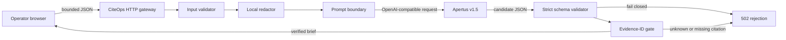

# CiteOps architecture

## Deployment modes

### Hosted demonstration

The CiteOps container calls the hosted `swiss-ai/apertus-v1.5-8b` model over
HTTPS. Redaction happens before the network boundary. This is convenient for a
hackathon demonstration, but it is not the strongest privacy configuration.

### On-premise / air-gapped target

The same image points `LLM_BASE_URL` to an OpenAI-compatible Apertus server on
the private network. The UI ships inside the container, and no external browser
assets or telemetry are loaded. After image and model weights are staged, the
runtime path does not require public internet access.

## Trust boundaries

1. Browser input is untrusted and bounded before parsing or inference.
2. Log text is untrusted data even after input validation.
3. The model endpoint is untrusted to return valid, supported, or small output.
4. Only deterministic schema and citation checks authorize display.

The model cannot execute commands, call tools, fetch URLs, write files, or
trigger operational changes through CiteOps.
